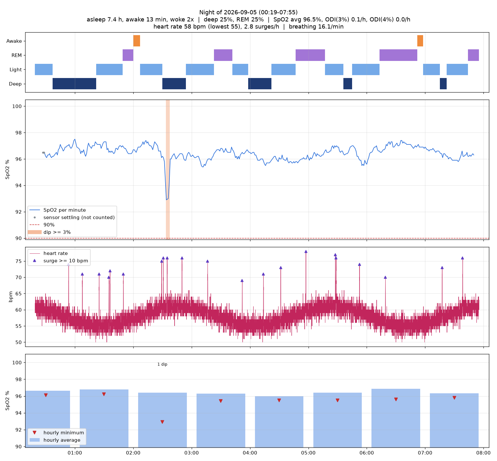
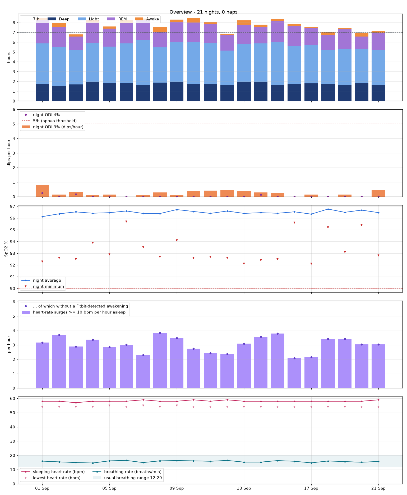
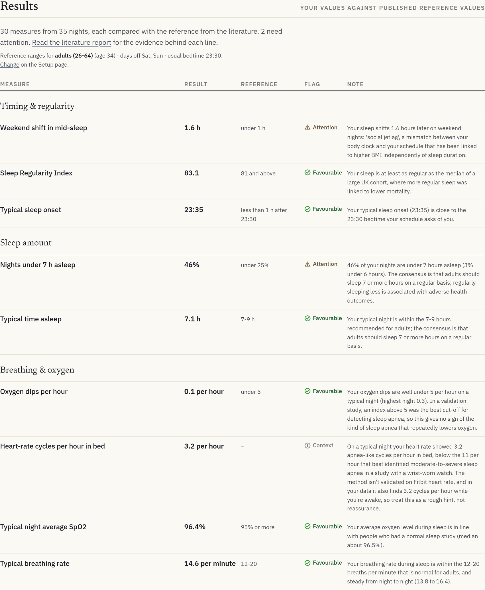

# Sleep Report

Download your watch's overnight blood oxygen (SpO2), sleep stages, heart rate and breathing rate, from a
Fitbit or Pixel Watch through the Google Health API or from an Apple Watch through an Apple Health export,
and turn them into graphs and numbers you can look at yourself or take to a doctor:

- a **graph per night and per nap**: sleep stages, SpO2 minute by minute, and per-hour averages
- **oxygen dips per hour** (ODI), the screening measure for sleep apnea
- **heart-rate surges per hour**: short heart-rate spikes that usually come with brief arousals
- **breathing rate** per night
- **apnea-like heart-rate cycles** (CVHR), a sleep-apnea screen from heart rate that doesn't depend on the smoothed SpO2
- **HRV and resting heart rate** compared with Fitbit users your age, and **off nights** when several signals left your normal
- **mood and mental health context**: what large studies found about sleep timing, irregular sleep, short
  sleep and insomnia in relation to depression, anxiety and alertness (population-level, never a score)
- a **sleep diary** showing when you slept every night, coloured by sleep stage
- an **overview** of time asleep, dips and oxygen level across all nights
- a **stats table** with bedtime, time asleep, awake time, efficiency, deep/REM %, SpO2, ODI, heart rate and breathing
- a **web app** to browse it all, with a **literature report**: like Promethease does for DNA, it connects
  each of your measurements to published findings, with the citations



> **This is not a medical device.** A wrist watch smooths its readings and misses short dips, so
> a normal result doesn't rule out sleep apnea. If you snore, stop breathing in your sleep or
> always wake up tired, see a doctor and ask about a sleep study.

*All images in this README are made from synthetic data.*

---

## What you need

- A Fitbit or Pixel Watch that measures SpO2, worn to bed and synced with the
  **Google Health app** (the former Fitbit app) on your phone.
- A **Google account**. This is the one your Fitbit is linked to. A personal Gmail account works.
- **Or an Apple Watch** with sleep tracking on. Its data comes from an export of the Health app instead of
  Google. Blood oxygen and heart rate are measured too rarely for a few analyses; see
  [docs/apple-watch.md](docs/apple-watch.md). With an Apple Watch, skip step 2 below.
- **Python 3.11 or newer** ([python.org](https://www.python.org/downloads/)) and **Node.js 20 or newer**
  ([nodejs.org](https://nodejs.org/)) for the app.

## Setup (one time, about 15 minutes)

### 1. Install

```bash
git clone <this repo> sleep-report
cd sleep-report
python -m pip install -e .
cd web
npm install
```

`pip install -e .` installs the Python dependencies and the `sleep_report` package from this folder. The
commands below are written as `python -m sleep_report <command>`, run from the project folder; after the
install, `sleep-report <command>` works too.

### 2. Create a Google Cloud project (Fitbit and Pixel Watch only)

Google only lets programs read your health data through an app you register yourself. It's free.

1. Go to [console.cloud.google.com](https://console.cloud.google.com/) and create a **new project**,
   for example `spo2tracker`.
2. Open **APIs & Services → Library**, search for **Google Health API** and click **Enable**.
3. Open **Google Auth Platform** (also called *OAuth consent screen*) and click **Get started**:
   - App name: anything, for example `spo2tracker`. Support email: your own address.
   - **Audience: External.** You can't choose *Internal* with a personal Google account.
     That's fine: while the app is in *Testing*, only the test users you add can sign in.
   - Finish the wizard.
4. **Audience** page: leave the publishing status on **Testing**. Under **Test users**, click
   **+ Add users** and add the Google account your Fitbit is linked to.
5. **Data Access** page: click **Add or remove scopes**, filter on *Google Health API*, and tick both:
   - `.../auth/googlehealth.health_metrics_and_measurements.readonly` (SpO2)
   - `.../auth/googlehealth.sleep.readonly` (sleep stages)

   Click **Update**, then **Save**.
6. **Clients** page (or *APIs & Services → Credentials*): **Create client**:
   - Application type: **Web application**
   - Authorized redirect URI: **`http://localhost:8080/`** (exactly like this, including the trailing `/`)
   - Click **Create**, then **Download JSON**. Save the file in this folder as **`client_secret.json`**.

### 3. Open the app and follow Setup

```bash
cd web
npm run dev
```

Open **http://127.0.0.1:5173**. Without data the app opens on its **Setup** page, which walks you through
the rest and shows what's done:

1. **Google credentials:** checks that `client_secret.json` is in place.
2. **Sign in with Google:** a browser tab opens. Pick your Fitbit's Google account and allow access,
   ticking **both** checkboxes. Google will warn that the app isn't verified; that's expected for your
   own app, so click **Advanced → Go to …**.
3. **Download your data:** choose how far back (90 days the first time) and click **Download**. The first
   download takes a few minutes.
4. **About you:** your age, days off, the bedtime your schedule asks of you, shift work and daytime
   tiredness. These pick the reference ranges in the literature report (see the table below). Saving
   rebuilds the report.

**With an Apple Watch,** choose **Apple Watch** in the first step. Setup then asks you to export your data on the
iPhone (Health app, your profile picture, **Export All Health Data**), send the `export.zip` to the computer and
upload it on the page. Upload a fresh export whenever you want newer nights.

Come back to **Setup** whenever you want new data (**Download new data**) or need to sign in again.
The output of each step shows at the bottom of the page.

| Setting | Used for |
|---|---|
| Age | Age-group reference ranges: teenagers 14-17, young adults 18-25, adults 26-64, older adults 65+. Findings based only on adult studies become context for teenagers. Below 14 isn't supported. |
| Days off | The nights before these days are "free nights" when measuring social jetlag. |
| Usual bedtime | Late sleep timing is measured from this bedtime. |
| Shift work | Skips the late-timing and social-jetlag findings, which assume a day schedule. |
| Often tired | "No" hides the note that normal oxygen doesn't rule out a breathing-related cause of tiredness. |

Without settings, the report uses adult ranges, Saturday and Sunday as days off and a 23:00 bedtime.
They're saved in `settings.json` (format: [`settings.example.json`](settings.example.json)).

The Setup page runs the same Python commands you can also run yourself, through a small bridge in the
local dev server ([`web/api-plugin.ts`](web/api-plugin.ts)). It only answers requests from the app on
this computer.

## Command line

Everything the Setup page does also works from a terminal in the project folder:

```bash
python -m sleep_report auth                     # sign in with Google
python -m sleep_report setup                    # age and schedule (asks five questions)
python -m sleep_report status                   # what's done
python -m sleep_report fetch --days 90          # first time: download up to 90 days of history
python -m sleep_report import-apple export.zip  # Apple Watch: import an Apple Health export instead of fetch
python -m sleep_report report                   # make graphs and the stats table
```

The first `fetch` takes a few minutes: heart rate comes in a reading every ~2 seconds and is
downloaded for every sleep. Later fetches only download new sleeps.

After that, run this once a week or so:

```bash
python -m sleep_report fetch --days 7
python -m sleep_report report
python -m sleep_report report --night 2026-10-26  # just one night (named by the evening it started)
```

**Every 7 days you have to sign in again** (`python -m sleep_report auth`). Google expires sign-ins
for apps in *Testing* mode after a week. The script tells you when that's needed.

## What you get

Everything goes into `reports/`:

| File | What it shows |
|---|---|
| `stats.txt` | The table below, plus medians across all nights |
| `night-YYYY-MM-DD.png` | One night: sleep stages with brief awakenings, SpO2 per minute with dips highlighted, heart rate with surges, hourly SpO2 average/minimum |
| `nap-YYYY-MM-DD-HHMM.png` | The same for each nap |
| `sleep-diary.png` | Every night on one row, 18:00 to 18:00, coloured by sleep stage |
| `summary.png` | Across all nights: time asleep per stage, SpO2 dips and level, heart-rate surges, sleeping heart rate and breathing rate |

### The table

```
                      bed-up      asleep awake eff% deep  REM wakes  |  SpO2   min  <90%  ODI3  ODI4  |   HR surg/h breath
2026-09-05            00:19-07:55    7.4    13   97   25   25     2  |  96.5  92.9   0.0   0.1   0.0  |   58    2.8   16.1
```

| Column | Meaning |
|---|---|
| bed-up | Start and end of the sleep |
| asleep | Hours asleep |
| awake | Minutes awake while in bed |
| eff% | Sleep efficiency: share of the time in bed you were asleep |
| deep, REM | Share of sleep in deep and REM sleep |
| wakes | Times awake during the night, including brief awakenings (30 s to a few minutes) |
| SpO2, min | Average and lowest blood oxygen |
| <90% | Share of the night with oxygen below 90% |
| ODI3, ODI4 | **Oxygen desaturation index**: dips of at least 3% / 4% per hour |
| HR | Median heart rate while asleep |
| surg/h | Heart-rate surges of at least 10 bpm per hour asleep |
| breath | Breaths per minute, Fitbit's average for the night |

**ODI guide:** under 5 per hour is normal, 5–15 mild, 15–30 moderate, over 30 severe.
**Breathing rate** at rest is usually 12–20 per minute.



## Web app and literature report

```bash
python -m sleep_report export  # writes the app's data into web/public/data/
cd web
npm install                    # first time only (needs Node.js 20+)
npm run dev                    # then open http://127.0.0.1:5173
```

Run `python -m sleep_report export` again after every `fetch` and reload the page. It has five sections:

| Section | What's there |
|---|---|
| **Overview** | A results table of your values against reference values from the literature, with a flag per line; the sleep diary; night-by-night trends. Hover any chart for values, click a night to open it. |
| **Nights** | Every night and nap as a sortable table. |
| **Night** | One night: sleep stages with brief awakenings, SpO2, and heart rate on one time axis with a shared crosshair, plus a list of events. |
| **Summary** | Everything at a glance on a few printable pages: your details, what stands out, measurements against reference values, the sleep diary, limitations and sources. Print it or save it as PDF from the page. |
| **Literature** | The literature report: one entry per finding with your value, a magnitude (0–4, how much it's worth reading), a flag (attention / favourable / context), the evidence, and numbered references with PubMed and DOI links. |

The Overview's results table: each measure against the reference from the literature, with a flag and a note
(the first of its groups; the full table also covers heart, recovery, naps, sleep quality and mood).



The sleep diary: every night on one row, 18:00 to 18:00, coloured by sleep stage, with naps on the row
of the night they precede.


The app follows your system's light or dark setting; the button in the top right switches between
auto, light and dark. It prints cleanly as a report.

### How the literature report works

The findings live in [`sleep_report/literature.json`](sleep_report/literature.json). Each one names a
metric (from [`sleep_report/metrics.py`](sleep_report/metrics.py)) and a set of value bands; the band
your value falls in decides the text, flag and magnitude. Findings without a metric are general context.
Every reference was checked against PubMed (title, journal, PMID, DOI) and every number in the texts
against the paper's abstract or full text. Where a cut-off is the report's own choice rather than the
literature's, the finding says so.

**How many nights it needs.** One night says little about what's typical, so there's no literature report
below **7 nights**; the sleep diary and night pages work from the first night. Each finding shows how many
nights its own data covers ("based on 96 nights"); that can be fewer than you recorded, for example when
the watch gave no HRV for a night. Findings that take longer to settle wait for more nights and say how
many are still needed:

| Nights | Findings |
|---|---|
| 7 | everything else |
| 14 | HRV for your age, sleep regularity, spread of sleep length, irregular sleep and mood or heart |
| 28 | off nights, deep sleep, social jetlag |

These minimums come from one person's three months of data: how many consecutive nights it took for a
finding to give the same verdict as all of them. More nights are always better; with 7, about half the
findings agree with what three months show. A month or more gives a report you can rely on.

Ranges can be limited to age groups with `"groups": ["teen", "young_adult", "adult", "older"]` on a
band (or a whole finding), and findings can be skipped with `"skip_if": ["shiftWork"]` or
`"skip_if_false": ["oftenTired"]`. `"basis": "staged_nights"` names the count of nights a finding rests
on (default `nights`; the counts are in `metrics.py`), and `"minNights": 14` holds the finding back until
that count is reached. To add a finding, add its references to `references` and an entry
to `findings`, then run `python -m sleep_report export`. Texts can use `{metric}` placeholders, for example `{asleep_h:.1f}`, and
`{name_clock}` for clock times such as `{bedtime_clock}`.

## How it works

This describes a Fitbit, which gives the most detail. With an Apple Watch, nights, stages, breathing rate,
resting heart rate and wrist temperature come from the Health export instead, and the analyses that need
dense readings (dips, surges, heart-rate cycles) are left out; see [docs/apple-watch.md](docs/apple-watch.md).

- **Nights and naps** come from Fitbit's own sleep sessions. Fitbit marks the main sleep of each
  day, and everything else counts as a nap. A night runs from 18:00 to 18:00 and is named after the
  evening it started. For SpO2 history from before you had sleep data, nights and naps are guessed
  from when the watch was recording.
- **SpO2** values are minute-by-minute readings that Google has already filtered for reliability.
  Gaps in the line are minutes Google rejected, usually because of movement.
- **Sensor settling:** the first 2 minutes after a gap read about 1 point low while the watch's
  averaging warms up. They're drawn as grey dots and not counted.
- **Dips:** a dip is when SpO2 falls at least 3 (or 4) points below your level over the
  previous 10 minutes, and it ends when it recovers. Drops that last longer than 5 minutes are a
  slow change in level, not a breathing pause, and count once at most.
- **Brief awakenings:** Fitbit lists awakenings of 30 seconds to a few minutes separately from
  the sleep stages. They're drawn as ticks on the stage strip and counted in *wakes*.
- **Heart-rate surges:** heart rate comes in every ~2 seconds and, unlike SpO2, is barely
  smoothed. A surge is a rise of at least 10 bpm above the median of the previous minute that
  lasts at least 6 seconds. Readings during Fitbit's *awake* stages are left out. Brief arousals
  and breathing events usually cause one, so surges can show restlessness that's too short for
  Fitbit to call "awake". The report also says how many surges had no Fitbit-detected awakening
  nearby, and what share of Fitbit's brief awakenings came with a surge (a check that both
  see the same thing).
- **Breathing rate** is Fitbit's own per-night summary. It's matched to the sleep that ended
  shortly before it was recorded.
- **Apnea-like heart-rate cycles (CVHR):** follows the published ACAT method (Hayano et al. 2011,
  2020): inter-beat intervals at 2 Hz, smoothed over 20 s; dips of 10-120 s that are deep relative to
  the surrounding 130 s; cycles of 25-130 s with similar waveforms and regular lengths; counted per
  hour in bed. Fitbit's 2-second heart rate isn't a validated input, so the report also shows the rate
  it finds while you're awake, which is noise.
- **HRV, resting heart rate, skin temperature** are Fitbit's daily summaries for the morning you woke
  up. HRV is compared with RMSSD values of 8.2 million Fitbit users by age (20-60). An Apple Watch
  measures HRV as SDNN, a different measure, so it isn't compared.
- **Off nights:** heart rate, HRV, breathing rate and skin temperature are compared with your previous
  28 nights; two or more signals more than 2 robust standard deviations off, in the direction illness
  or alcohol push them, make an off night.

### Limits

- The watch heavily smooths its readings, so short dips get flattened. This tool's ODI will be
  **lower** than a medical oximeter's.
- Some apnea causes brief awakenings without a big oxygen drop. That doesn't show up in SpO2 at all.
- Sleep stages from a wrist watch are estimates. They're good for trends, not exact per-minute truth.
- There's no medical normal range for heart-rate surges measured at the wrist. Use them to compare
  your own nights, not as a diagnosis. Breathing problems typically cause a surge every 30–90
  seconds, dozens per hour, often in a repeating pattern.

## Troubleshooting

| Problem | Fix |
|---|---|
| *Access blocked: … has not completed the Google verification process* (`403 access_denied`) | The account you signed in with isn't a **test user**. Add it on the Audience page (step 2.4), or sign in with the right account. |
| *Google hasn't verified this app* | Expected for your own app. Click **Advanced → Go to …**. |
| `auth` keeps waiting after you allowed access | If the browser shows an error page at `localhost:8080`, copy the whole address-bar URL, paste it into the terminal and press Enter. |
| `Token refresh failed` | The weekly sign-in expired. Run `python -m sleep_report auth`. |
| `API error 403` / `MISSING_OAUTH_SCOPE` | A permission is missing. Check both scopes on the Data Access page (step 2.5), run `auth` again and tick every checkbox. |
| `Sleep: skipped - no sleep access yet` | Same: add the sleep scope and run `auth` again. |
| `Port 8080 is in use` | Close whatever uses port 8080 and try again. |
| `No nights with enough data` | Run `fetch` first. Check that the watch was worn to bed, SpO2 tracking is on in the app, and the watch has synced. |
| *Needs at least 7 nights* / a finding says how many more nights it needs | Not an error: wear the watch to bed for more nights, then `fetch` and `export` again. On the first download, `fetch --days 90` gets up to 90 days of history. |
| Empty or very little data | Sign in to the **Google Health app** on your phone with the same Google account, and let it sync. |

## Several people on one computer

Set `SLEEP_REPORT_HOME` to a folder to keep someone's data, settings and report there instead of in the project
folder, for example `SLEEP_REPORT_HOME=~/sleep-anna npm run dev` in `web`, and the same variable for any
`python -m sleep_report` command. Each folder can use a different device. Google credentials (`client_secret.json`) stay
in the project folder.

## Privacy

Everything stays on your computer. The only network traffic is to Google, to sign in and download
your own data (with an Apple Watch there is none: you upload the export to the app on your own computer). These files hold your password-like keys or your health data, and are kept out of git
by `.gitignore`:

| File | Contents |
|---|---|
| `client_secret.json` | Your app's credentials from Google Cloud |
| `settings.json` | Your device, age and schedule |
| `token.json` | Your sign-in, which grants read access to your health data |
| `data/spo2.csv` | Every SpO2 reading: UTC time, local time, percentage |
| `data/sleep.json` | Your sleep sessions and stages |
| `data/breathing.json` | Breathing rate per night |
| `data/heart_rate/` | Heart rate during each sleep, one CSV per sleep |
| `data/daily.json` | Daily HRV, resting heart rate and sleep temperature |
| `data/source.json` | Which device the data came from |
| `reports/` | The generated graphs and table |
| `web/public/data/`, `web/dist/` | Your data as exported for the web app, and a production build that includes it |

Never commit or share `client_secret.json` or `token.json`.

## Project layout

```
pyproject.toml                    Python package, dependencies and the `sleep-report` command
sleep_report/
  cli.py                          command line: auth, fetch, import-apple, report, setup, status, export
  store.py                        the data format every source writes, and the local data files
  sources/google.py               Fitbit and Pixel Watch: Google sign-in and Google Health API downloads
  sources/apple.py                Apple Watch: Apple Health export import
  analysis.py                     nights and naps, sleep summaries, SpO2 dips, heart-rate surges
  cvhr.py                         apnea-like heart-rate cycles (ACAT method)
  recovery.py                     HRV, resting heart rate, temperature; off nights
  metrics.py                      whole-period metrics: medians, sleep regularity index, social jetlag, HRV norms
  settings.py                     settings.json and `setup`: age group, days off, usual bedtime
  literature.py, literature.json  the literature report: findings, bands, references
  export.py                       JSON for the web app
  plots.py                        per-night graphs, overview, sleep diary
tests/                            unit tests and an end-to-end test on a generated Apple Health export
web/                              the React app (Vite + TypeScript, hand-built SVG charts)
docs/                             notes on other devices; example images for this README (synthetic data)
```

## Tests

```bash
python -m unittest       # from the project folder; no extra packages needed
cd web && npm run typecheck
```

A new device goes in `sleep_report/sources/`: it writes the files described at the top of
[`sleep_report/store.py`](sleep_report/store.py), and everything after that works unchanged.
