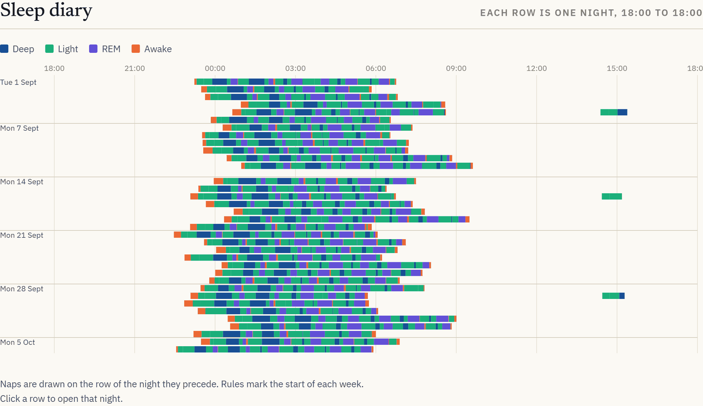

# Sleep Report

Turn your watch's sleep data into graphs, numbers and a literature report you can read yourself or take to a
doctor. Works with a Fitbit or Pixel Watch (through the Google Health API) and an Apple Watch (through an Apple
Health export). Everything runs on your own computer.

- **Each night and nap:** sleep stages, blood oxygen (SpO2) minute by minute, and heart rate.
- **Breathing and oxygen:** oxygen dips per hour (ODI, the usual screen for sleep apnea), apnea-like heart-rate
  cycles (CVHR) and breathing rate.
- **Heart and recovery:** heart-rate surges during sleep, HRV and resting heart rate against Fitbit users your
  age, and *off nights* when several signals left your normal.
- **Sleep timing:** a diary of every night, sleep regularity, social jetlag and late timing.
- **A literature report** that connects each measurement to published studies, with citations, the way
  Promethease does for DNA. It includes what large studies found about sleep and mood, as population-level
  context, never a score.


> **This is not a medical device.** A wrist watch smooths its readings and misses short dips, so a normal
> result doesn't rule out sleep apnea. If you snore, stop breathing in your sleep or always wake up tired, see a
> doctor and ask about a sleep study.

*All images in this README are made from synthetic data.*

## What you need

- A **Fitbit or Pixel Watch** that measures SpO2, worn to bed and synced with the Google Health app (formerly
  the Fitbit app), and the Google account it's linked to. A personal Gmail account works.
- Or an **Apple Watch** with sleep tracking on. It measures blood oxygen and heart rate too rarely for some
  analyses; see [docs/apple-watch.md](docs/apple-watch.md).
- **Python 3.11+** and **Node.js 20+**.

## Setup (once, about 15 minutes)

### 1. Install

```bash
git clone <this repo> sleep-report
cd sleep-report
python -m pip install -e .
cd web && npm install
```

This also installs a `sleep-report` command, the same as `python -m sleep_report`.

### 2. Create a Google Cloud project (Fitbit and Pixel Watch only)

Google only lets programs read your health data through an app you register yourself. It's free.

1. In [console.cloud.google.com](https://console.cloud.google.com/), create a **new project**, for example
   `spo2tracker`.
2. **APIs & Services → Library:** find **Google Health API** and click **Enable**.
3. **Google Auth Platform** (or *OAuth consent screen*) → **Get started:** any app name, your own support email,
   **Audience: External**. *Internal* isn't available for personal accounts, and while the app is in *Testing*
   only the test users you add can sign in.
4. **Audience:** leave the status on **Testing** and add your Fitbit's Google account under **Test users**.
5. **Data Access → Add or remove scopes:** filter on *Google Health API*, tick both, then **Update** and **Save**:
   - `.../auth/googlehealth.health_metrics_and_measurements.readonly` (SpO2)
   - `.../auth/googlehealth.sleep.readonly` (sleep stages)
6. **Clients → Create client:** type **Web application**, redirect URI **`http://localhost:8080/`** (with the
   trailing `/`). Click **Create**, then **Download JSON**, and save it in the project folder as
   **`client_secret.json`**.

### 3. Open the app and follow Setup

```bash
cd web
npm run dev
```

Open **http://127.0.0.1:5173**. Without data, the app opens on its **Setup** page:

1. **Google credentials:** checks that `client_secret.json` is in place.
2. **Sign in with Google:** pick your Fitbit's account and tick **both** checkboxes. Google warns that the app
   isn't verified; that's expected for your own app, so click **Advanced → Go to …**.
3. **Download your data:** 90 days the first time, which takes a few minutes.
4. **About you:** see the table below.

**With an Apple Watch,** choose **Apple Watch** in the first step. On the iPhone, open the Health app, tap your
profile picture and **Export All Health Data**, then upload the `export.zip` on the page. Upload a fresh export
for newer nights.

Come back to Setup for new data or to sign in again: Google ends sign-ins for apps in *Testing* mode after
7 days.

| Setting | Used for |
|---|---|
| Age | Reference ranges for teenagers 14-17, young adults 18-25, adults 26-64 and older adults 65+. Findings based only on adult studies are context for teenagers. Below 14 isn't supported. |
| Days off | The nights before them count as free nights for social jetlag. |
| Usual bedtime | Late sleep timing is measured from it. |
| Shift work | Skips the late-timing and social-jetlag findings, which assume a day schedule. |
| Often tired | "No" hides the note that normal oxygen doesn't rule out a breathing-related cause of tiredness. |

Without settings, the report uses adult ranges, Saturday and Sunday off and a 23:00 bedtime. Settings are saved
in `settings.json` (format: [`settings.example.json`](settings.example.json)).

The Setup page runs the commands below through a small bridge in the dev server
([`web/api-plugin.ts`](web/api-plugin.ts)), which only answers requests from this computer.

## Command line

```bash
python -m sleep_report auth                       # sign in with Google (again every 7 days)
python -m sleep_report setup                      # age and schedule
python -m sleep_report status                     # what's done
python -m sleep_report fetch --days 90            # download history; afterwards --days 7 gets new nights
python -m sleep_report import-apple export.zip    # Apple Watch, instead of fetch
python -m sleep_report export                     # data for the web app
python -m sleep_report report                     # graphs and the stats table in reports/
python -m sleep_report report --night 2026-10-26  # one night, named by the evening it started
```

The first `fetch` takes a few minutes because heart rate comes every ~2 seconds. Later fetches only download
new sleeps. Run `export` after every `fetch` and reload the app.

## The app

| Section | What's there |
|---|---|
| **Overview** | Your values against reference values from the literature, the sleep diary and night-by-night trends. Hover a chart for values; click a night to open it. |
| **Nights** | Every night and nap as a sortable table. |
| **Night** | Sleep stages with brief awakenings, SpO2 and heart rate on one time axis, and a list of events. |
| **Summary** | A few printable pages: your details, what stands out, measurements against reference values, the diary, limitations and sources. |
| **Literature** | One entry per finding: your value, a magnitude (0–4, how much it's worth reading), a flag (attention, favourable or context), the evidence and numbered references with PubMed and DOI links. |

It follows your system's light or dark setting (the button in the top right overrides it) and prints cleanly.

The Overview's results table (first groups only):


The sleep diary, one night per row from 18:00 to 18:00, with naps on the row of the night they precede:



## Graphs and stats table

`python -m sleep_report report` writes these to `reports/`:

| File | What it shows |
|---|---|
| `stats.txt` | The table below, plus medians across all nights |
| `night-YYYY-MM-DD.png` | One night: sleep stages with brief awakenings, SpO2 with dips highlighted, heart rate with surges, hourly SpO2 average and minimum |
| `nap-YYYY-MM-DD-HHMM.png` | The same for each nap |
| `sleep-diary.png` | Every night on one row, 18:00 to 18:00, coloured by sleep stage |
| `summary.png` | Across all nights: time asleep per stage, SpO2 dips and level, heart-rate surges, sleeping heart rate and breathing rate |

```
                      bed-up      asleep awake eff% deep  REM wakes  |  SpO2   min  <90%  ODI3  ODI4  |   HR surg/h breath
2026-09-05            00:19-07:55    7.4    13   97   25   25     2  |  96.5  92.9   0.0   0.1   0.0  |   58    2.8   16.1
```

| Column | Meaning |
|---|---|
| bed-up | Start and end of the sleep |
| asleep | Hours asleep |
| awake | Minutes awake in bed |
| eff% | Sleep efficiency: share of the time in bed spent asleep |
| deep, REM | Share of sleep in deep and REM sleep |
| wakes | Times awake, including brief awakenings of 30 s to a few minutes |
| SpO2, min | Average and lowest blood oxygen |
| <90% | Share of the night with oxygen below 90% |
| ODI3, ODI4 | Oxygen desaturation index: dips of at least 3% or 4% per hour |
| HR | Median heart rate asleep |
| surg/h | Heart-rate surges of at least 10 bpm per hour asleep |
| breath | Breaths per minute, Fitbit's average for the night |

**ODI:** under 5 per hour is normal, 5–15 mild, 15–30 moderate, over 30 severe. **Breathing rate** at rest is
usually 12–20 per minute.


## The literature report

Each finding in [`sleep_report/literature.json`](sleep_report/literature.json) names a metric from
[`sleep_report/metrics.py`](sleep_report/metrics.py) and a set of value bands; the band your value falls in
decides the text, flag and magnitude. Findings without a metric are general context. Every reference was checked
against PubMed (title, journal, PMID, DOI) and every number against the paper's abstract or full text. Where a
cut-off is the report's own choice, the finding says so.

### How many nights it needs

There's no literature report below **7 nights**; the diary and night pages work from the first night. Each
finding shows how many nights its own data covers ("based on 96 nights"), which can be fewer than you recorded,
for example when the watch gave no HRV for a night. Findings that take longer to settle say how many nights they
still need:

| Nights | Findings |
|---|---|
| 7 | everything else |
| 14 | HRV for your age, sleep regularity, spread of sleep length, irregular sleep and mood or heart |
| 28 | off nights, deep sleep, social jetlag |

These minimums come from one person's three months of data: how many consecutive nights it took for each finding
to give the same verdict as all of them. With 7 nights about half the findings agree with three months; a month
or more gives a report you can rely on.

### Adding a finding

Add its references to `references` and an entry to `findings`, then run `python -m sleep_report export`.

- `"groups": ["teen", "young_adult", "adult", "older"]` on a band or finding limits it to those age groups.
- `"skip_if": ["shiftWork"]` and `"skip_if_false": ["oftenTired"]` skip it based on the settings.
- `"basis": "staged_nights"` names the count of nights it rests on (default `nights`; the counts are in
  `metrics.py`), and `"minNights": 14` holds it back until that count is reached.
- Texts can use `{metric}` placeholders such as `{asleep_h:.1f}`, and `{name_clock}` for clock times such as
  `{bedtime_clock}`.

## How it works

This describes a Fitbit, which gives the most detail. With an Apple Watch, nights, stages, breathing rate,
resting heart rate and wrist temperature come from the Health export, and the analyses that need dense readings
(dips, surges, heart-rate cycles) are left out; see [docs/apple-watch.md](docs/apple-watch.md).

- **Nights and naps** are Fitbit's own sleep sessions: the main sleep of each day is the night, everything else
  a nap. A night runs from 18:00 to 18:00 and is named after the evening it started. For SpO2 history from before
  you had sleep data, nights and naps are guessed from when the watch was recording.
- **SpO2** is minute by minute, already filtered for reliability by Google. Gaps are minutes Google rejected,
  usually because of movement. The first 2 minutes after a gap read about 1 point low while the watch's
  averaging warms up; they're drawn as grey dots and not counted.
- **Dips:** SpO2 at least 3 (or 4) points below your level over the previous 10 minutes, until it recovers.
  Drops lasting over 5 minutes are a change in level, not a breathing pause, and count once at most.
- **Brief awakenings** of 30 seconds to a few minutes are listed by Fitbit separately from the stages. They're
  drawn as ticks on the stage strip and counted in *wakes*.
- **Heart-rate surges:** heart rate comes every ~2 seconds and, unlike SpO2, is barely smoothed. A surge is a
  rise of at least 10 bpm above the median of the previous minute, lasting at least 6 seconds, outside Fitbit's
  *awake* stages. Brief arousals and breathing events usually cause one, so surges show restlessness too short
  for Fitbit to call awake. The report also counts surges without a nearby Fitbit awakening, and the share of
  Fitbit's brief awakenings that came with a surge, as a check that both see the same thing.
- **Breathing rate** is Fitbit's per-night summary, matched to the sleep that ended shortly before it.
- **Apnea-like heart-rate cycles (CVHR)** follow the published ACAT method (Hayano et al. 2011, 2020):
  inter-beat intervals at 2 Hz smoothed over 20 s; dips of 10-120 s that are deep relative to the surrounding
  130 s; cycles of 25-130 s with similar waveforms and regular lengths; counted per hour in bed. Fitbit's 2-second
  heart rate isn't a validated input, so the report also shows the rate found while you're awake, which is noise.
- **HRV, resting heart rate and skin temperature** are Fitbit's daily summaries for the morning you woke up. HRV
  is compared with the RMSSD of 8.2 million Fitbit users by age (20-60). Apple Watch HRV is SDNN, a different
  measure, so it isn't compared.
- **Off nights:** heart rate, HRV, breathing rate and skin temperature are compared with your previous 28 nights.
  Two or more signals more than 2 robust standard deviations off, in the direction illness or alcohol push them,
  make an off night.

### Limits

- The watch smooths its readings and flattens short dips, so the ODI here is **lower** than a medical
  oximeter's.
- Some apnea causes brief awakenings without a big oxygen drop, which SpO2 doesn't show.
- Sleep stages from a wrist watch are estimates: good for trends, not exact minute by minute.
- There's no medical normal range for heart-rate surges at the wrist; use them to compare your own nights.
  Breathing problems typically cause a surge every 30–90 seconds, dozens per hour, often in a repeating pattern.

## Troubleshooting

| Problem | Fix |
|---|---|
| *Access blocked: … has not completed the Google verification process* (`403 access_denied`) | The account isn't a **test user**. Add it on the Audience page (step 2.4), or sign in with the right account. |
| *Google hasn't verified this app* | Expected for your own app. Click **Advanced → Go to …**. |
| `auth` keeps waiting after you allowed access | If the browser shows an error page at `localhost:8080`, paste the whole address-bar URL into the terminal and press Enter. |
| `Token refresh failed` | The weekly sign-in expired. Run `python -m sleep_report auth`. |
| `API error 403` / `MISSING_OAUTH_SCOPE` | A permission is missing. Check both scopes on the Data Access page (step 2.5), run `auth` again and tick every checkbox. |
| `Sleep: skipped - no sleep access yet` | Same: add the sleep scope and run `auth` again. |
| `Port 8080 is in use` | Close whatever uses port 8080 and try again. |
| `No nights with enough data` | Run `fetch` first. Check that the watch was worn to bed, SpO2 tracking is on and the watch has synced. |
| *Needs at least 7 nights*, or a finding needs more nights | Not an error. Wear the watch to bed for more nights, then `fetch` and `export` again. |
| Empty or very little data | Sign in to the Google Health app on your phone with the same Google account and let it sync. |

## Several people on one computer

Set `SLEEP_REPORT_HOME` to keep someone's data, settings and report in their own folder, for example
`SLEEP_REPORT_HOME=~/sleep-anna npm run dev` in `web`, and the same for any `python -m sleep_report` command. Each
folder can use a different device. `client_secret.json` stays in the project folder.

## Privacy

Everything stays on your computer. The only network traffic is to Google, to sign in and download your own data;
with an Apple Watch there is none. These files hold keys or health data and are kept out of git by `.gitignore`:

| File | Contents |
|---|---|
| `client_secret.json` | Your app's credentials from Google Cloud |
| `token.json` | Your sign-in, which grants read access to your health data |
| `settings.json` | Your device, age and schedule |
| `data/spo2.csv` | Every SpO2 reading: UTC time, local time, percentage |
| `data/sleep.json` | Sleep sessions and stages |
| `data/breathing.json` | Breathing rate per night |
| `data/heart_rate/` | Heart rate during each sleep, one CSV per sleep |
| `data/daily.json` | Daily HRV, resting heart rate and sleep temperature |
| `data/source.json` | Which device the data came from |
| `reports/` | The generated graphs and table |
| `web/public/data/`, `web/dist/` | Your data exported for the app, and a production build that includes it |

Never commit or share `client_secret.json` or `token.json`.

## Project layout

```
pyproject.toml                    Python package, dependencies and the `sleep-report` command
sleep_report/
  cli.py                          command line: auth, fetch, import-apple, report, setup, status, export
  store.py                        the data format every source writes, and the local data files
  sources/google.py               Fitbit and Pixel Watch: Google sign-in and Google Health API downloads
  sources/apple.py                Apple Watch: Apple Health export import
  analysis.py                     nights and naps, sleep summaries, SpO2 dips, heart-rate surges
  cvhr.py                         apnea-like heart-rate cycles (ACAT method)
  recovery.py                     HRV, resting heart rate, temperature; off nights
  metrics.py                      whole-period metrics: medians, sleep regularity index, social jetlag, HRV norms
  settings.py                     settings.json and `setup`: age group, days off, usual bedtime
  literature.py, literature.json  the literature report: findings, bands, references
  export.py                       JSON for the web app
  plots.py                        per-night graphs, overview, sleep diary
tests/                            unit tests and an end-to-end test on a generated Apple Health export
web/                              the React app (Vite + TypeScript, hand-built SVG charts)
docs/                             notes on other devices; example images for this README (synthetic data)
```

## Tests

```bash
python -m unittest           # from the project folder; no extra packages needed
cd web && npm run typecheck
```

A new device goes in `sleep_report/sources/`: it writes the files described at the top of
[`sleep_report/store.py`](sleep_report/store.py), and everything after that works unchanged.
